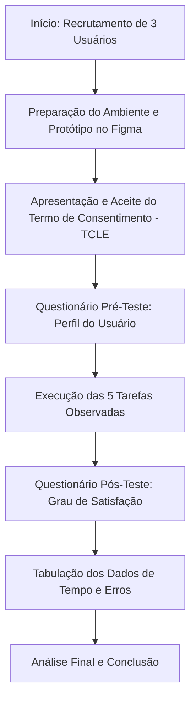

# 13. Avaliação de Usabilidade por Observação do Usuário

**[1 solução completa por pessoa da equipe]**

**Método de Avaliação de Usabilidade por Observação do Usuário**  
**(o número de usuários observados é igual o número de membros da equipe)**

---

## 1) Fluxograma de Avaliação de Usabilidade por Observação do Usuário [1 solução por equipe]

---

## 2) DESCRIÇÃO DO PROCEDIMENTO DE PREPARAÇÃO DO TESTE [1 solução por equipe]

**Passo 1: Recrutamento e Preparação do Ambiente**  
Selecionamos 3 usuários reais com perfis semelhantes às personas do projeto (jovens e universitários que costumam organizar viagens em grupo). O teste foi realizado remotamente via chamada de vídeo com compartilhamento de tela. O usuário acessou o link do protótipo navegável no Figma, enquanto um membro da equipe moderava a sessão e os demais cronometravam o tempo e anotavam os erros de navegação.

**Passo 2: Lista de tarefas que o usuário deve cumprir**  
Pedimos para os usuários realizarem 5 tarefas fundamentais no sistema **FEI Viagens**, sem receberem dicas de onde clicar:
* **Tarefa 1:** Cadastrar-se no aplicativo e acessar o painel principal ("Minhas viagens").
* **Tarefa 2:** Criar uma nova viagem chamada "Praia 2026" com datas definidas.
* **Tarefa 3:** Acessar a aba de Roteiro da viagem e votar em um restaurante na enquete ativa.
* **Tarefa 4:** Acessar a aba Financeiro, adicionar uma despesa de R$ 150,00 (Mercado) e dividir igualmente entre o grupo.
* **Tarefa 5:** Verificar os saldos pendentes, copiar a chave Pix de um participante e confirmar o pagamento no sistema.

**Passo 3: Formulário de perfil do usuário (Pré-teste)**  
Aplicamos um questionário rápido antes do início das tarefas para registrar idade, frequência de viagens em grupo por ano e quais ferramentas utilizam atualmente para organizar roteiros e dividir gastos (ex: WhatsApp, Excel, Splitwise).

**Passo 4: Termo de Consentimento Livre e Esclarecido (TCLE)**  
Apresentamos o termo antes da gravação, garantindo o anonimato dos dados e deixando claro que o objetivo do teste é avaliar a usabilidade do protótipo "FEI Viagens", e não a capacidade pessoal do usuário.

**Passo 5: Questionário de Satisfação (Pós-teste)**  
Ao término das 5 tarefas, coletamos a percepção de satisfação do participante em cada etapa e abrimos espaço para comentários e sugestões livres sobre a interface.

---
