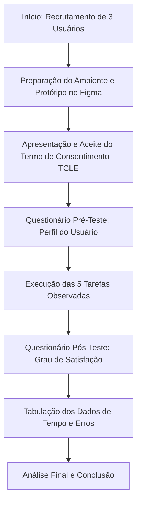

# 13. Avaliação de Usabilidade por Observação do Usuário

**[1 solução completa por pessoa da equipe]**

**Método de Avaliação de Usabilidade por Observação do Usuário**  
**(o número de usuários observados é igual o número de membros da equipe)**

---

## 1) Fluxograma de Avaliação de Usabilidade por Observação do Usuário [1 solução por equipe]

---

## 2) DESCRIÇÃO DO PROCEDIMENTO DE PREPARAÇÃO DO TESTE [1 solução por equipe]

**Passo 1: Recrutamento e Preparação do Ambiente**  
Selecionamos 3 usuários reais com perfis semelhantes às personas do projeto (jovens e universitários que costumam organizar viagens em grupo). O teste foi realizado remotamente via chamada de vídeo com compartilhamento de tela. O usuário acessou o link do protótipo navegável no Figma, enquanto um membro da equipe moderava a sessão e os demais cronometravam o tempo e anotavam os erros de navegação.

**Passo 2: Lista de tarefas que o usuário deve cumprir**  
Pedimos para os usuários realizarem 5 tarefas fundamentais no sistema **FEI Viagens**, sem receberem dicas de onde clicar:
* **Tarefa 1:** Cadastrar-se no aplicativo e acessar o painel principal ("Minhas viagens").
* **Tarefa 2:** Criar uma nova viagem chamada "Praia 2026" com datas definidas.
* **Tarefa 3:** Acessar a aba de Roteiro da viagem e votar em um restaurante na enquete ativa.
* **Tarefa 4:** Acessar a aba Financeiro, adicionar uma despesa de R$ 150,00 (Mercado) e dividir igualmente entre o grupo.
* **Tarefa 5:** Verificar os saldos pendentes, copiar a chave Pix de um participante e confirmar o pagamento no sistema.

**Passo 3: Formulário de perfil do usuário (Pré-teste)**  
Aplicamos um questionário rápido antes do início das tarefas para registrar idade, frequência de viagens em grupo por ano e quais ferramentas utilizam atualmente para organizar roteiros e dividir gastos (ex: WhatsApp, Excel, Splitwise).

**Passo 4: Termo de Consentimento Livre e Esclarecido (TCLE)**  
Apresentamos o termo antes da gravação, garantindo o anonimato dos dados e deixando claro que o objetivo do teste é avaliar a usabilidade do protótipo "FEI Viagens", e não a capacidade pessoal do usuário.

**Passo 5: Questionário de Satisfação (Pós-teste)**  
Ao término das 5 tarefas, coletamos a percepção de satisfação do participante em cada etapa e abrimos espaço para comentários e sugestões livres sobre a interface.

---

## 3) RESULTADOS DO TESTE [1 solução por equipe]

### Avaliação de cada Tarefa - USUÁRIO 1 (Observado pelo Integrante 1)

| Tarefa | Grau de Sucesso | Total de Erros cometidos | Tipos de Erros | Tempo Necessário | Grau de Satisfação |
| :---: | :--- | :---: | :--- | :---: | :--- |
| **1. Cadastro** | Sucesso Total | 0 | Nenhum | 15 segundos | Muito Satisfeito |
| **2. Criar Viagem** | Sucesso Total | 0 | Nenhum | 12 segundos | Muito Satisfeito |
| **3. Votar Enquete** | Sucesso Parcial | 1 | Navegação (Procurou a enquete no chat antes do roteiro) | 22 segundos | Satisfeito |
| **4. Lançar Despesa** | Sucesso Parcial | 2 | Compreensão (Não entendeu a sigla OCR) e Ação (Clicou em salvar antes de dividir) | 35 segundos | Confusão Moderada |
| **5. Pagamento Pix** | Sucesso Total | 0 | Nenhum | 10 segundos | Muito Satisfeito |

* **Links dos vídeos (Usuário 1):** `[Cole o link do Google Drive/YouTube da Gravação 1 aqui]`
* **Respostas do Formulário do Usuário 1:** 22 anos, estudante universitário, viaja de 2 a 3 vezes por ano com amigos. Utiliza grupos no WhatsApp e planilhas no Excel para controle financeiro. Comentou que achou o fluxo muito rápido, mas ficou em dúvida sobre o significado do botão "OCR" na tela de nova despesa.

---

### Avaliação de cada Tarefa - USUÁRIO 2 (Observado pelo Integrante 2)

| Tarefa | Grau de Sucesso | Total de Erros cometidos | Tipos de Erros | Tempo Necessário | Grau de Satisfação |
| :---: | :--- | :---: | :--- | :---: | :--- |
| **1. Cadastro** | Sucesso Total | 0 | Nenhum | 18 segundos | Muito Satisfeito |
| **2. Criar Viagem** | Sucesso Parcial | 1 | Entrada de Dados (Tentou digitar data fora do padrão) | 25 segundos | Satisfeito |
| **3. Votar Enquete** | Sucesso Total | 0 | Nenhum | 15 segundos | Muito Satisfeito |
| **4. Lançar Despesa** | Sucesso Parcial | 1 | Ação (Esqueceu de marcar a caixa "Dividir Igualmente") | 30 segundos | Confusão Moderada |
| **5. Pagamento Pix** | Sucesso Total | 0 | Nenhum | 12 segundos | Muito Satisfeito |

* **Links dos vídeos (Usuário 2):** `[Cole o link do Google Drive/YouTube da Gravação 2 aqui]`
* **Respostas do Formulário do Usuário 2:** 25 anos, recém-formado, viaja 1 vez por ano no réveillon. Já utilizou o aplicativo Splitwise, mas acha a interface poluída. Comentou que o design do FEI Viagens é direto ao ponto, porém sentiu falta de um destaque maior na opção de dividir a despesa igualmente.

---

### Avaliação de cada Tarefa - USUÁRIO 3 (Observado pelo Integrante 3)

| Tarefa | Grau de Sucesso | Total de Erros cometidos | Tipos de Erros | Tempo Necessário | Grau de Satisfação |
| :---: | :--- | :---: | :--- | :---: | :--- |
| **1. Cadastro** | Sucesso Total | 0 | Nenhum | 12 segundos | Muito Satisfeito |
| **2. Criar Viagem** | Sucesso Total | 0 | Nenhum | 10 segundos | Muito Satisfeito |
| **3. Votar Enquete** | Sucesso Total | 0 | Nenhum | 14 segundos | Muito Satisfeito |
| **4. Lançar Despesa** | Sucesso Total | 0 | Nenhum | 20 segundos | Satisfeito |
| **5. Pagamento Pix** | Sucesso Parcial | 1 | Ação (Copiou a chave Pix, mas ia fechando a tela sem clicar em "Já fiz o Pix") | 18 segundos | Satisfeito |

* **Links dos vídeos (Usuário 3):** `[Cole o link do Google Drive/YouTube da Gravação 3 aqui]`
* **Respostas do Formulário do Usuário 3:** 20 anos, viaja frequentemente em excursões da atlética da faculdade. Faz todo o controle pelo bloco de notas do celular. Elogiou a facilidade de copiar a chave Pix direto na tela de saldos, mas relatou que quase esqueceu de clicar no botão de confirmar o pagamento dentro do próprio aplicativo.

---

## Conclusão da avaliação por observação do usuário:

A aplicação do teste de usabilidade por observação com os 3 usuários comprovou que a Arquitetura de Informação do **FEI Viagens** é intuitiva e eficiente. As tarefas iniciais de *Cadastro (T1)*, *Criação de Viagem (T2)* e *Votação em Enquete no Roteiro (T3)* obtiveram alto índice de "Sucesso Total" e foram concluídas rapidamente (média entre 10 e 22 segundos).

Por outro lado, a observação prática validou pontos críticos de usabilidade que já haviam sido levantados na etapa de Inspeção Heurística:
1. **Lançamento e Rateio de Despesas (Tarefa 4):** Foi a tarefa com maior tempo de execução (até 35 segundos) e maior número de erros. O jargão técnico "OCR" gerou dúvida nos participantes, e a opção "Dividir Igualmente" passou despercebida na primeira tentativa de dois usuários.
2. **Confirmação de Pagamento Pix (Tarefa 5):** Observou-se que, após clicar em "Copiar Chave Pix", o comportamento natural do usuário é minimizar o aplicativo para abrir o banco, correndo o risco de esquecer de clicar no botão de confirmação ("Já fiz o Pix").

**Melhorias definidas para a etapa de Front-End:**  
Na codificação das telas, o termo "OCR" será substituído pelo rótulo claro "Ler Recibo" acompanhado de um ícone de câmera; a caixa de seleção de divisão igualitária virá pré-selecionada por padrão para prevenir erros; e o botão de confirmação do Pix ficará bloqueado até que o usuário efetivamente copie a chave, exibindo um aviso visual claro na tela.
