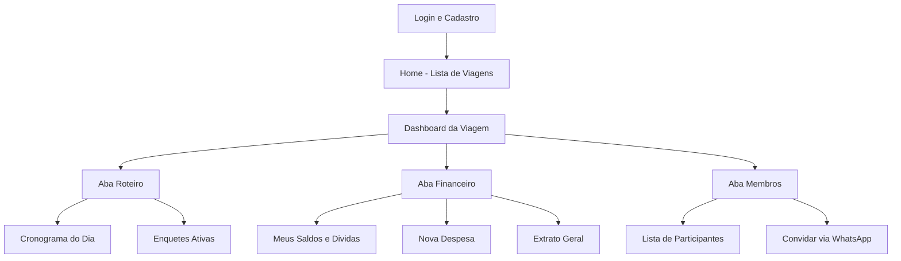
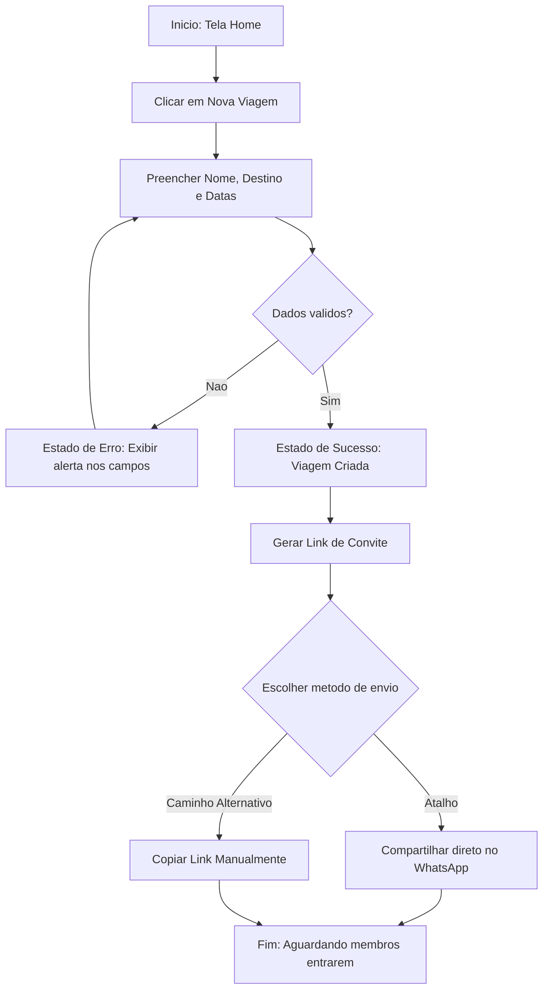
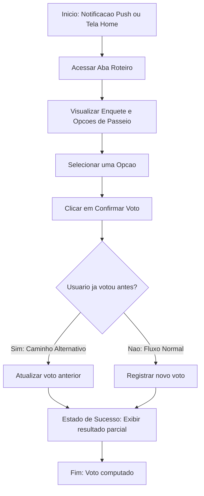
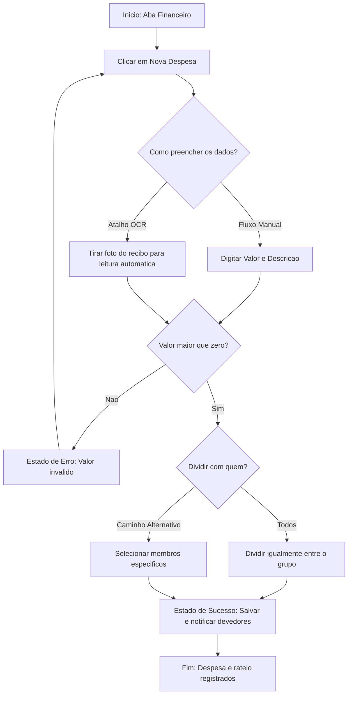
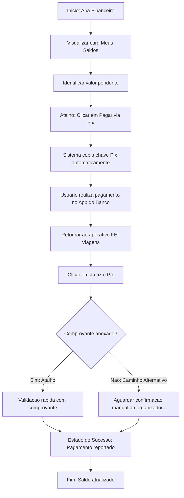

# Arquitetura de Informação e Fluxo do Usuário

1) **Arquitetura de Informação (Sitemap)**

- Liste todas as telas/seções principais do produto ou serviço.
  * **Tela de Login e Cadastro:** Autenticação e criação de conta do usuário.
  * **Home (Lista de Viagens):** Visualização de viagens ativas, passadas e botão para criar nova viagem.
  * **Dashboard da Viagem (Navegação Inferior):**
    * **Aba Roteiro:** Cronograma do dia, criação de enquetes e votação de passeios.
    * **Aba Financeiro:** Meus saldos, cadastro de nova despesa (manual ou via leitura OCR de recibo) e extrato geral do grupo.
    * **Aba Membros:** Lista de participantes da viagem e geração de link de convite.

- Organize essas telas em uma hierarquia (diagrama de sitemap), mostrando como estão agrupadas e conectadas.

- Justifique a organização escolhida com base nas necessidades identificadas nas personas e cenários.
  * A organização em três abas inferiores (Bottom Navigation) centraliza a navegação sem exigir cliques profundos. Isso resolve diretamente a necessidade da persona **Maria Clara (Organizadora)**, que precisa separar os momentos de lazer (roteiro) das cobranças (financeiro) para reduzir a sobrecarga mental e o estresse com o grupo. Além disso, atende ao **Kauan (Participante Prático)**, que deseja acessar suas pendências financeiras instantaneamente com apenas um toque na "Aba Financeiro", sem precisar procurar informações em menus escondidos ou ler longos históricos de mensagens no WhatsApp.

2) **Fluxo do Usuário (User Flow)**

- Para cada funcionalidade escolhida, desenhe o fluxograma de passos que o usuário percorre do início ao fim da tarefa (pontos de decisão, telas intermediárias, estados de erro/sucesso).
- Destaque possíveis atalhos ou caminhos alternativos.

**Funcionalidade 1: Criar Viagem e Convidar Amigos**
- **Explicação e objetivo do usuário:** Permite cadastrar um novo evento de viagem definindo destino e datas. O objetivo da organizadora (Maria Clara) é iniciar o planejamento rapidamente e trazer os amigos para a plataforma de forma ágil.
- **Atalhos ou caminhos alternativos:** O sistema oferece o compartilhamento direto pelo botão nativo do WhatsApp (atalho rápido) ou a opção de copiar o link manualmente para a área de transferência (caminho alternativo).

**Funcionalidade 2: Votar em Enquete de Roteiro**
- **Explicação e objetivo do usuário:** Permite escolher entre opções de passeios ou restaurantes sugeridos pelo grupo. O objetivo do participante (Kauan/Samir) é decidir o roteiro de maneira democrática e rápida, sem precisar discutir em longas conversas de chat.
- **Atalhos ou caminhos alternativos:** Acesso direto à tela de votação tocando na notificação push do celular (atalho), além do caminho alternativo de alterar e atualizar o voto caso o usuário já tenha votado anteriormente.

**Funcionalidade 3: Registrar Despesa e Calcular Rateio**
- **Explicação e objetivo do usuário:** Permite cadastrar um gasto coletivo (como mercado ou combustível) e dividir o valor entre os membros. O objetivo da organizadora (Maria Clara) é automatizar o cálculo de quanto cada pessoa deve, eliminando o uso de planilhas externas.
- **Atalhos ou caminhos alternativos:** Uso da câmera para leitura automática do valor na nota fiscal via OCR (atalho) em vez da digitação manual, e o caminho alternativo de selecionar apenas membros específicos caso alguém não tenha participado daquele gasto.

**Funcionalidade 4: Pagar Dívida via Pix (Copia e Cola)**
- **Explicação e objetivo do usuário:** Permite consultar o saldo devedor consolidado e realizar a quitação via Pix. O objetivo do participante prático (Kauan) é pagar sua parte da viagem com o menor número de cliques possível.
- **Atalhos ou caminhos alternativos:** O botão "Pagar via Pix" copia automaticamente a chave ou código Pix para a área de transferência do celular (atalho), evitando o caminho alternativo demorado de precisar abrir o chat do grupo para pedir a chave ao organizador.

