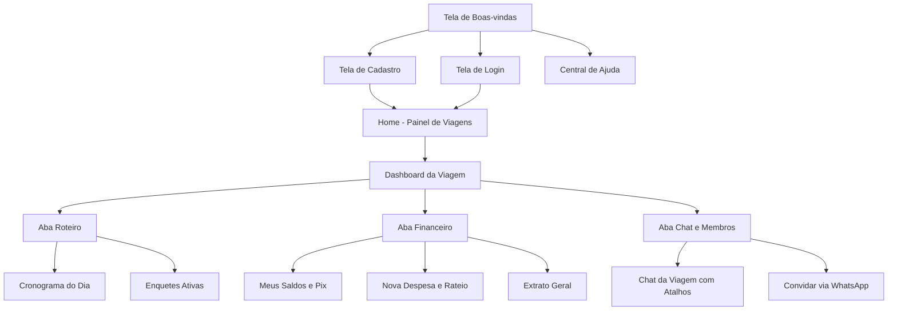
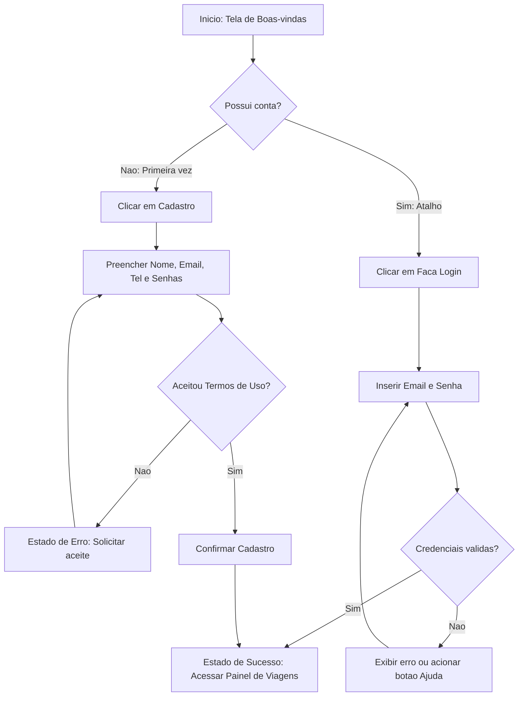
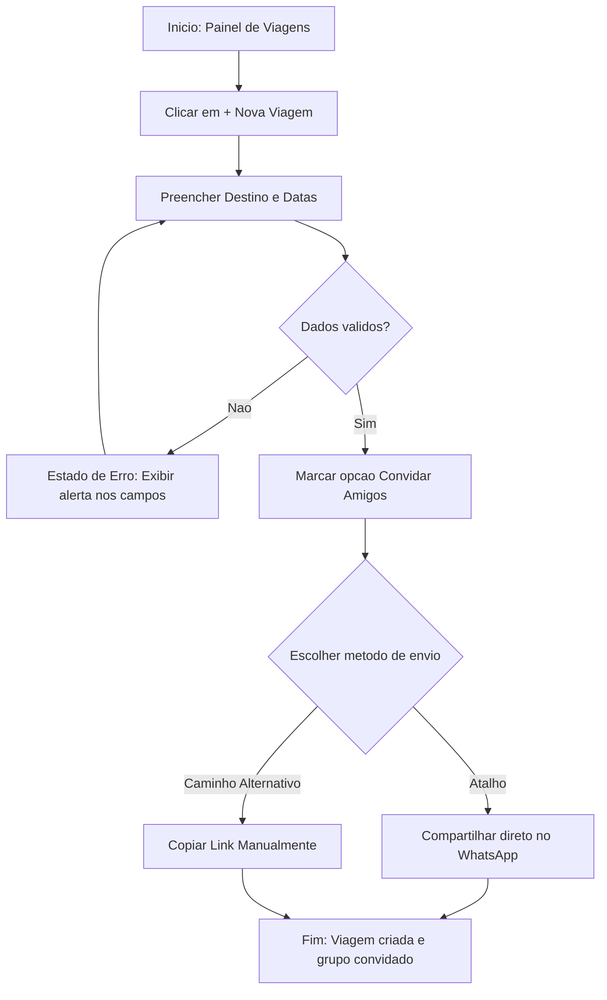
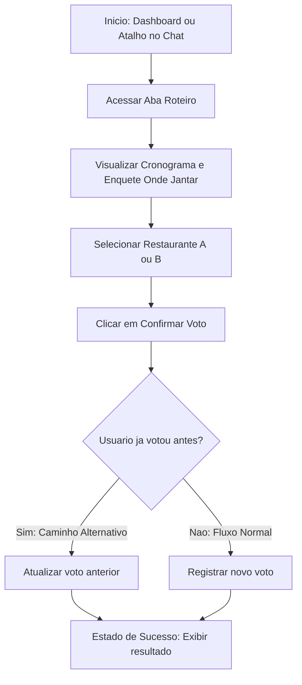
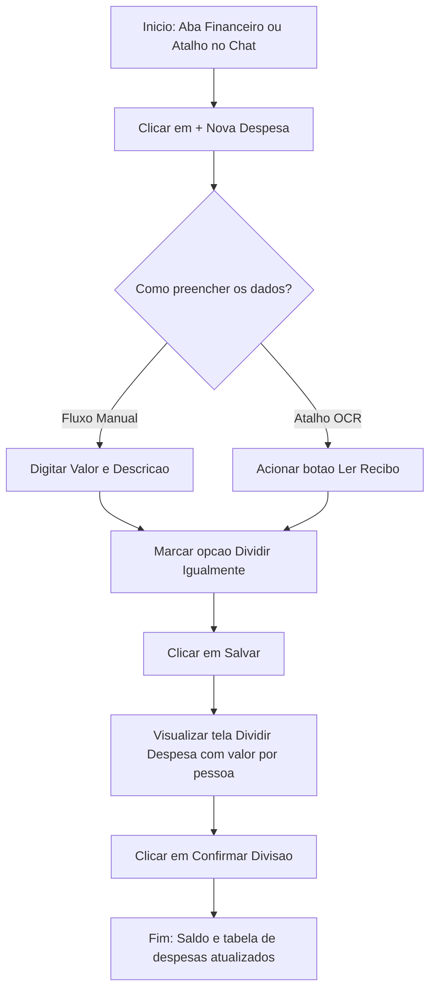
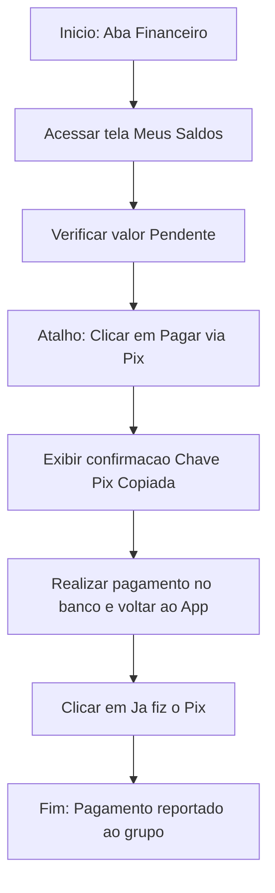

# Arquitetura de Informação e Fluxo do Usuário

1) **Arquitetura de Informação (Sitemap)**

- Liste todas as telas/seções principais do produto ou serviço.
  * **Tela de Boas-vindas (Landing Page):** Apresentação ("Toda viagem começa com um plano!"), botões para Cadastro, Login e botão de suporte ("Ajuda?").
  * **Tela de Cadastro:** Formulário com Nome, E-mail, Telefone, Senha, Confirmar Senha e aceite dos Termos de Uso.
  * **Tela de Login:** Acesso rápido ("Bem-vindo de volta") com E-mail e Senha.
  * **Home (Painel de Viagens):** Lista/Grade de viagens ativas, menu de configurações e botão para criar nova viagem.
  * **Dashboard da Viagem:**
    * **Aba Roteiro:** Cronograma do dia em linha do tempo e votação de enquetes.
    * **Aba Financeiro:** Saldo, tabela/extrato de despesas recentes, cadastro de nova despesa (com leitura de recibo) e divisão de gastos.
    * **Aba Chat e Membros:** Chat interno da viagem (com atalhos rápidos para Enquete e Despesas), lista de participantes e convite via WhatsApp.

- Organize essas telas em uma hierarquia (diagrama de sitemap), mostrando como estão agrupadas e conectadas.

- Justifique a organização escolhida com base nas necessidades identificadas nas personas e cenários.
  * A separação inicial entre "Primeira vez aqui (Cadastro)" e "Faça Login" facilita a entrada de novos membros convidados por link sem confundir quem já tem conta. Dentro da viagem, a divisão clara entre Roteiro, Financeiro e um Chat Interno próprio (equipado com botões de atalho direto para criar Enquetes e Despesas acima do teclado) resolve a dor da persona **Maria Clara (Organizadora)**, evitando que informações importantes se percam no meio de conversas aleatórias do WhatsApp, ao mesmo tempo em que oferece praticidade para o **Kauan (Participante Prático)** acessar seus saldos e votar rapidamente.

2) **Fluxo do Usuário (User Flow)**

- Para cada funcionalidade escolhida, desenhe o fluxograma de passos que o usuário percorre do início ao fim da tarefa (pontos de decisão, telas intermediárias, estados de erro/sucesso).
- Destaque possíveis atalhos ou caminhos alternativos.

**Funcionalidade 1: Realização de Cadastro e Login**
- **Explicação e objetivo do usuário:** Permite que um novo viajante crie sua conta informando dados básicos ou acesse uma conta existente para entrar no planejamento do grupo.
- **Atalhos ou caminhos alternativos:** Na tela inicial, usuários já cadastrados utilizam o caminho direto para "Faça Login", além de contarem com um botão de atalho para a área de "Ajuda?" caso tenham dificuldades no acesso.

**Funcionalidade 2: Criar Viagem e Convidar Amigos**
- **Explicação e objetivo do usuário:** Permite cadastrar um novo evento de viagem definindo destino e datas. O objetivo da organizadora é iniciar o planejamento rapidamente e trazer os amigos para a plataforma.
- **Atalhos ou caminhos alternativos:** O modal de criação já inclui a caixa de seleção "Convidar amigos" integrada ao botão de compartilhamento direto via WhatsApp (atalho).

**Funcionalidade 3: Votar em Enquete de Roteiro (Via Aba Roteiro ou Atalho do Chat)**
- **Explicação e objetivo do usuário:** Permite consultar o cronograma do dia e votar em opções de passeios ou restaurantes ("Onde jantar?").
- **Atalhos ou caminhos alternativos:** O usuário pode acessar a enquete diretamente pelo botão de atalho rápido "Enquete" dentro da tela de Chat da viagem, sem precisar navegar pelo menu principal.

**Funcionalidade 4: Registrar Despesa e Calcular Rateio**
- **Explicação e objetivo do usuário:** Permite cadastrar um gasto coletivo (como Mercado ou Gasolina) e dividir o valor igualmente entre os participantes (ex: Luigi, Cesar e Maria).
- **Atalhos ou caminhos alternativos:** Uso do botão "Ler Recibo" (câmera/anexo) para preenchimento rápido e acesso direto à criação de despesas pela barra de atalhos do Chat da viagem.

**Funcionalidade 5: Pagar Dívida via Pix**
- **Explicação e objetivo do usuário:** Permite consultar o saldo pendente (ex: R$ 50,00) na tela "Meus Saldos" e copiar a chave Pix para quitação rápida.
- **Atalhos ou caminhos alternativos:** O botão "Pagar via Pix" copia automaticamente a chave para a área de transferência, seguido do botão rápido "Já fiz o Pix!" para baixa imediata.

